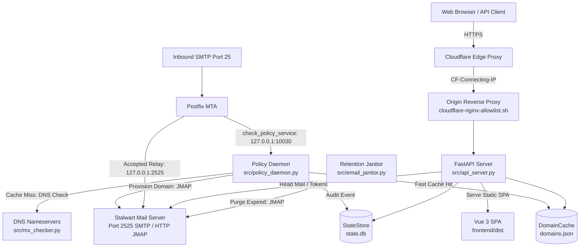

# Architecture and security constraints

TMail coordinates domain provisioning and web access while Postfix owns SMTP transport and Stalwart owns message storage. This guide records the boundaries and decisions that maintainers must preserve.

For setup, see the [README](../README.md). For host operations and upgrades, see [deployment and operations](deployment.md). For access policy, see [mailbox access](mailbox-access.md). Contributor commands live in [AGENT.md](../AGENT.md).

---

## System topology and boundaries

TMail acts as an orchestration and access layer in front of Postfix (the Mail Transfer Agent) and Stalwart (the Mail Delivery Agent and JMAP store).

### Component Roles & Boundaries

- **Postfix Policy Daemon ([`src/policy_daemon.py`](../src/policy_daemon.py))**:
  - Listens on `127.0.0.1:10030` via TCP line protocol, registered as a recipient restriction in [`deploy/postfix_main_snippet.cf`](../deploy/postfix_main_snippet.cf).
  - Executed synchronously on incoming SMTP `RCPT TO` commands.
  - A cache hit against [`src/domain_cache.py:DomainCache`](../src/domain_cache.py) returns `action=OK` without repeating MX verification.
  - A cache miss triggers an MX lookup via [`src/mx_checker.py`](../src/mx_checker.py). If the domain's MX points to `mx_hostname`, the daemon dynamically provisions the domain in Stalwart via JMAP ([`src/jmap_client.py`](../src/jmap_client.py)), updates `DomainCache`, and emits an audit event to [`src/api_state.py:StateStore`](../src/api_state.py).
- **Web & Admin API ([`src/api_server.py`](../src/api_server.py), [`src/admin_api.py`](../src/admin_api.py))**:
  - FastAPI application providing public Hydra REST endpoints ([`src/api_models.py`](../src/api_models.py)), administrator endpoints (`/admin/api/*`), static asset delivery, and SPA routing.
  - Mailbox endpoints provide token-based inspection, with passwords required for protected addresses.
  - The SPA catch-all route explicitly guards reserved system paths (`_SPA_RESERVED`) so mailbox local-parts cannot shadow application endpoints.
- **Retention Janitor ([`src/email_janitor.py`](../src/email_janitor.py))**:
  - Independent maintenance utility triggered by [`deploy/tmail-janitor.timer`](../deploy/tmail-janitor.timer).
  - Queries Stalwart via JMAP for messages older than `retention_days` and batches their deletion, and purges expired user-deleted message backups from [`src/deleted_mail.py:DeletedMailStore`](../src/deleted_mail.py).
- **Frontend SPA ([`frontend/`](../frontend/))**:
  - Vue 3 + TypeScript single-page application governed by the [frontend design guidelines](design-guidelines.md).

### The Stalwart & Postfix Boundary

TMail intentionally avoids managing low-level mail transport:
- **No SMTP or Transport Ownership**: Postfix exclusively owns port 25 and network inbound relay. Stalwart exclusively owns physical message storage, indexing, and mailbox allocation.
- **No TLS or DNS Configuration**: TMail does not generate TLS certificates or modify external DNS zone files.
- **Web-Only Domain Suppression**: When an administrator blocks a domain via the admin console (`blacklisted_domains`), the domain is suppressed only from the public web UI and API. Postfix and Stalwart continue accepting and delivering email for that domain, preventing administrative disruption or dropped relay traffic.

---

## Persistence layers

TMail partitions persistence between two independent stores with distinct performance profiles:

| Store | Underlying Mechanism | Executable Owner | Primary Purpose | Concurrency Model |
|---|---|---|---|---|
| **Domain Cache** | Atomic JSON file (`domains.json`) | [`src/domain_cache.py:DomainCache`](../src/domain_cache.py) | Instant lookup of MX-verified domains for Postfix SMTP checks | In-memory `set` synchronized via `fcntl.flock` and file generation tracking |
| **State Store** | SQLite database (`state.db`) | [`src/api_state.py:StateStore`](../src/api_state.py) | Relational storage: site settings, admin/unlock/mailbox sessions, password hashes, revocation generations, frozen domains, activity logs | Multi-process SQLite with `PRAGMA journal_mode=WAL` |
| **Deleted Mail Store** | SQLite database (`deleted_mail.db`) | [`src/deleted_mail.py:DeletedMailStore`](../src/deleted_mail.py) | 365-day admin-only backup of user-deleted emails (`DELETE /messages/{id}`) with zlib-compressed `.eml` source (up to 10 MiB raw) | Multi-process SQLite with `PRAGMA journal_mode=WAL`, `0600` permissions, and `PRAGMA auto_vacuum=INCREMENTAL` |

### State database upgrades and mailbox lifecycle

`StateStore` keeps the configured database path and serializes initialization with a
`<state_db>.migration.lock` filesystem lock. Before upgrading an existing version-zero
database, it uses SQLite's backup API, verifies integrity, fsyncs the backup, and
publishes a unique `.state-backup-*.sqlite3` file beside the database. The initializing
store exposes that path as `backup_path`. New empty databases need no historical
backup. Additive schema changes and `PRAGMA user_version` commit together; backup or
migration failure aborts startup. A retry may make another backup and preserves
previous backups. Backup files contain credentials and must stay private.

See [upgrades and rollback](deployment.md#upgrades-and-rollback) for worker
shutdown, backup handling, and the password-enforcement rollback boundary.

The storage/authentication layer in [`api_state.py`](../src/api_state.py) and
[`api_auth.py`](../src/api_auth.py) enforces mailbox password protection through the shared `mailbox_access` dependency
in [`api_server.py`](../src/api_server.py). Every mailbox route validates token
generation, expiry, and any parent admin session. The existing admin cookie remains
scoped to `/admin`; explicit CSRF-protected admin endpoints exchange it for a
mailbox bearer and reset/remove protection. Admin writes recheck the parent inside
the committing transaction.
`MailboxAuth` accepts addresses already validated by the caller's domain policy.
Lifecycle callers pass `elevated=True` only from a trusted site-unlock result or
validated mailbox bearer. Claim, login, change and removal preserve this domain
access in replacement tokens; elevation never bypasses mailbox password checks.
Password mismatches raise credential errors; verification failures and corrupt
stored hashes raise sanitized `PasswordServiceError` without exposing values.
It preserves exact 12–128-character passwords, uses Argon2id, and performs hashing
outside SQLite write transactions with two process-local hash slots, reserved before
thread offload and retained until the actual worker completes. Password endpoints
use the existing 10-request/60-second IP limiter; password-bearing login always
uses the IP bucket, even with site unlock. Generations
persist after password removal/expiry. Password mutations and lazy expiry revoke
previous tokens; successful visitor login renews protection without revoking
other devices. Visitor sessions expire 90 days after issuance, independently of
protection renewal. Admin mailbox sessions depend on a live parent session and
never renew protection. Reads never renew protection or delete email.

SSE streams revalidate authorization between polling waits of at most five seconds,
and again before emitting updates. A separate eight-worker authorization pool
keeps rechecks independent of ordinary mail requests; checks time out after five
seconds and close the stream on timeout or exhausted capacity. Authorization
workers retain their slots until completion even after timeout or disconnect.
Each stream has
one pending poll; eight process-wide slots bound outstanding polls. A disconnected
or revoked stream abandons its result but the worker retains capacity until it
actually finishes. Downloads revalidate before delivering bytes. Mailbox, token,
and admin responses use `Cache-Control: no-store`. Production hash calibration and
worker sizing remain release checks.

If a newly issued token is revoked before its response is constructed, issuance
returns `409 mailbox_conflict`; database/hash failures remain sanitized `503` errors.

### Why Persistence Is Partitioned

1. **Keep domain lookup independent of database transactions**: Postfix queries the policy daemon synchronously for every recipient. Storing accepted domains in SQLite would introduce lock contention and transaction overhead during inbound traffic spikes. `DomainCache` allows the daemon to serve lookups entirely from memory, refreshing only when the file generation tuple `(st_dev, st_ino, st_mtime_ns, st_size)` changes.
2. **Process Independence**: The policy daemon and API server run as decoupled OS processes. Neither process shares memory or coordinates via IPC sockets; coordination relies exclusively on POSIX atomic filesystem semantics and SQLite WAL mode.

---

## Security constraints

### Invariant 1: Untrusted Email Content Sandboxing
- **Invariant**: Arbitrary email HTML is treated as hostile and must never be rendered within the primary DOM context.
- **Enforcement**:
  - [`src/api_server.py`](../src/api_server.py) serves a stripped, isolated document shell (`_SANDBOX_DOCUMENT`) under `/message-sandbox` and `/sandbox`.
  - [`frontend/src/components/SandboxFrame.vue`](../frontend/src/components/SandboxFrame.vue) mounts the content inside an `<iframe>` restricted by `sandbox="allow-scripts allow-popups allow-popups-to-escape-sandbox"`.
  - Data transfer occurs strictly through window `postMessage` protocol after receipt of a ready signal.
  - [`frontend/vite.config.ts`](../frontend/vite.config.ts) sets `assetsInlineLimit: 0` to prohibit inlining web fonts as `data:` URIs. This preserves the strict Content Security Policy (`default-src 'self'`), which disallows inline font schemes.

### Invariant 2: Origin Firewalling under Cloudflare DNS Proxy
- **Invariant**: When deployed behind Cloudflare's DNS proxy (rather than Cloudflare Tunnel), the origin server must reject all direct non-Cloudflare HTTP connections.
- **Enforcement**:
  - [`src/api_server.py`](../src/api_server.py) trusts the incoming `CF-Connecting-IP` header unconditionally for rate-limiting client buckets (`/accounts`, `/token`, `/unlock`, `/admin/login`).
  - Because the origin server maintains a publicly reachable IP address, attackers could bypass Cloudflare and forge arbitrary `CF-Connecting-IP` headers if direct connections are permitted.
  - The origin firewall must restrict incoming HTTP/HTTPS ports to Cloudflare's published CIDR blocks using [`deploy/cloudflare-nginx-allowlist.sh`](../deploy/cloudflare-nginx-allowlist.sh) or OS firewall rules (`ufw` / `iptables`).

### Invariant 3: Public and Protected Inbox Access
- **Invariant**: Public mailbox tokens allocate no session; protected visitor and explicit admin access require revocable server-side sessions.
- **Enforcement**:
  - [`src/api_auth.py:AddressToken`](../src/api_auth.py) issues HMAC-SHA256 signed bearer tokens encoding the normalized address and authorization level, signed with `api_token_secret`.
  - Public tokens carry a mailbox generation; every authorization checks SQLite security state. Opaque visitor/admin tokens are stored only as hashes, and admin tokens also require a live parent session.

### Invariant 4: Runtime Config Immutability and Device/Inode Pinning
- **Invariant**: Code releases must be immutable, and runtime configuration mutations must be guarded against race conditions or tampering.
- **Enforcement**:
  - In the checkout-based systemd deployment, release artifacts under `/opt/tmail-policy` are read-only.
  - That deployment keeps runtime configuration separately at `/var/lib/tmail-policy/config.json`.
  - [`src/config.py:ConfigStore`](../src/config.py) applies updates via atomic temporary files with fsync, directory fsync, and `os.replace`.
  - [`deploy/install.sh`](../deploy/install.sh) and [`deploy/release.sh`](../deploy/release.sh) execute `python3 -m src.config install-runtime` and `remove-runtime` to record and verify the physical filesystem identity `(dev, inode)`, preventing accidental overwrites or symlink manipulation during promotions and rollbacks.

### Invariant 5: Single-Process API Ownership in Hybrid Deployments
- **Invariant**: A deployment host must never run conflicting API server instances across differing supervisors.
- **Enforcement**:
  - If the Web API is deployed via Docker Compose while the policy daemon runs as a systemd service on the host, the systemd unit `tmail-api.service` must be disabled (`sudo systemctl disable --now tmail-api.service`).
  - Failure to disable the host service results in two split-brain instances reading and writing divergent `config.json` files (one at `/var/lib/tmail-policy/config.json` and one inside Docker volume `tmail-data`).

### Invariant 6: Strict Port Allocation and Reverse Proxy Boundaries
- **Invariant**: Network listeners on the host must maintain disjoint port ownership to prevent public reverse proxy hijacking and internal API collisions.
- **Enforcement**:
  - **Port 25**: Postfix MTA (exclusive public SMTP listener).
  - **Port 2525**: Stalwart internal SMTP listener (receives relays from Postfix).
  - **Stalwart JMAP listener**: Deployment-specific; [`config.example.json`](../config.example.json) uses `http://127.0.0.1:8080/jmap/`.
  - **Port 8443**: Stalwart WebUI HTTPS listener (isolated from public web ports).
  - **Port 80 & 443**: Host Nginx Reverse Proxy (terminates public HTTP and Let's Encrypt TLS with HTTP/2 negotiation and upstream keep-alive connection pooling; configured via [`deploy/nginx-tmail.conf.example`](../deploy/nginx-tmail.conf.example)).
  - **Web listener**: Defaults to `127.0.0.1:8081` in [`compose.yaml`](../compose.yaml). [`.env.example`](../.env.example) changes it to `0.0.0.0:8080`; select a port that does not conflict with Stalwart and match the host proxy upstream.
  - **Port 8000**: Docker `api` container (FastAPI backend exposed within the Docker bridge network).
  - **Port 10030**: Postfix policy daemon bound to `127.0.0.1:10030`.

### Invariant 7: Network MTU 1500 Enforcement (Preventing PMTUD Black Holes)
- **Invariant**: On cloud virtualized environments with Jumbo Frame defaults (e.g., Oracle Cloud default MTU 9000), the primary network interface must be pinned to MTU 1500.
- **Enforcement**:
  - Cloudflare Anycast edge nodes connect via standard MTU 1500 (TCP MSS 1460). When an origin interface responds with MTU 9000 (MSS 8960), transit gateways drop frames exceeding 1500 bytes. When ICMP Fragmentation Needed is blackholed, connections stall indefinitely in `SYN-RECV` or `FIN-WAIT-1`, causing Cloudflare Error 522 timeouts.
  - Origin hosts must persist MTU 1500 in `/etc/netplan/99-mtu.yaml` (`dhcp4-overrides: {use-mtu: false}`), disable cloud-init network overrides via `/etc/cloud/cloud.cfg.d/99-disable-network-config.cfg`, and configure BBR with TCP timestamps disabled (`net.ipv4.tcp_timestamps = 0`) to prevent Anycast ECMP PAWS drops.

### Invariant 8: Decoupled Mailbox Runtime Locks & Debounced Domain Synchronization
- **Invariant**: Public mailbox reads and token operations must never stall behind administrative domain synchronization or upstream JMAP network latency.
- **Enforcement**:
  - [`src/api_server.py:mail_runtime`](../src/api_server.py) acquires `app.state.jmap_lock` exclusively, decoupling high-throughput mailbox and token readers from `app.state.admin_lock`.
  - [`src/admin_api.py:refresh_domains`](../src/admin_api.py) performs the synchronous `jmap.list_domains()` call strictly outside `admin_lock` to prevent blocking concurrent admin handlers during network latency.
  - A double-checked 60-second debounce window inside `admin_lock` prevents thundering-herd JMAP queries during concurrent traffic spikes.
  - [`src/api_auth.py:active_domains`](../src/api_auth.py) falls back to `state.get_frozen_domains()` whenever `cache.domains()` is temporarily empty, reducing empty domain responses when a saved list is available.

---

## Design decisions

| Decision | Context & Problem | Rejected Alternatives | Chosen Solution & Trade-offs |
|---|---|---|---|
| **Split Persistence Model** | Synchronous SMTP recipient validation must avoid repeated DNS and provisioning work for accepted domains. | Storing domains in SQLite (`state.db`) alongside site settings and activity logs. | Partitioned storage: `DomainCache` (`domains.json`) for instant in-memory sets; `StateStore` (`state.db`) for relational data. *Trade-off:* Requires managing two distinct files, but avoids a database transaction for the accepted-domain lookup. |
| **Web-Only Domain Suppression** | Administrators need to hide retired or problematic domains from the temporary mail interface without dropping existing inbound mail. | Propagating domain bans to Postfix transport maps or rejecting them at port 25. | Suppressing blacklisted domains exclusively in the public API and UI (`blacklisted_domains`). *Trade-off:* Inbound mail continues reaching Stalwart, but existing user workflows and administrative forwards do not suffer hard bounces. |
| **Generation-checked public tokens and revocable secured sessions** | Public inbox churn must stay cheap while password protection requires persistent revocation. | Per-public-token session rows or HMAC validation without security-state checks. | Signed public tokens allocate no session row; every authorization checks SQLite generation/protection. Protected visitor/admin sessions store only bearer hashes. Tombstones persist after removal/expiry, preventing old public tokens from regaining access. *Trade-off:* Reads require SQLite and fail closed on storage errors. |
| **Iframe Content Sandboxing** | Inbound emails contain arbitrary, untrusted HTML, SVG, and CSS from external senders that could exploit the web client. | HTML sanitization libraries (e.g., Bleach or DOMPurify) rendered directly into the host DOM. | Isolated sandbox `<iframe>` communicating solely through `postMessage`, combined with `assetsInlineLimit: 0` in Vite. *Trade-off:* Added asynchronous frame messaging complexity, but keeps untrusted content outside the application DOM. |
| **Origin IP Allowlisting for Cloudflare** | Rate-limiting buckets trust `CF-Connecting-IP` directly to track visitor request quotas. | Relying solely on edge WAF rules without origin port firewalling. | Enforcing origin-level IP allowlisting ([`deploy/cloudflare-nginx-allowlist.sh`](../deploy/cloudflare-nginx-allowlist.sh)) for all Cloudflare proxy deployments. *Trade-off:* Requires recurring cron synchronization of Cloudflare CIDRs, but prevents IP spoofing against origin ports. |
| **Filesystem Device/Inode Config Pinning** | Deployments and rollbacks must guarantee configuration integrity without downtime or file corruption. | In-place file edits or unpinned symlink directory switching. | CLI-managed atomic installs (`src.config install-runtime`) pinning `(dev, inode)` pairs. *Trade-off:* Deployment scripts require strict error handling and cleanup, but promotion can validate configuration and clean up failed installs. |
| **Stalwart Port 8443 Web Isolation & Host Nginx SSL** | Stalwart by default binds port 443, conflicting with public web reverse proxies and intercepting HTTPS traffic. | Running Nginx only on port 80 (Flexible SSL) without origin port 443 listener. | Relocating Stalwart HTTPS listener to port 8443 and terminating Let's Encrypt SSL on host Nginx ports 80/443. *Trade-off:* Requires managing SSL certificates on both Cloudflare and host Nginx, but separates public web traffic from Stalwart administration. |
| **Host MTU 1500 Pinning on Cloud VPS** | Cloud hypervisors (Oracle Cloud) assign MTU 9000, creating PMTUD black holes with Cloudflare Anycast edge nodes. | Relying on TCP MSS clamping at the firewall level. | Pinned host MTU 1500 via Netplan override and disabling cloud-init network updates. *Trade-off:* Slightly lower intra-VPC throughput, but addresses the recorded path-MTU failure on that host. |
| **Decoupled JMAP Locks & Debounced Domain Sync** | Synchronous JMAP domain listings (141KB payload) held `admin_lock`, stalling public mailbox readers and token checks, causing Cloudflare 522 timeouts. | Running unbounded background threads without locks or increasing proxy timeouts. | Partition `jmap_lock` from `admin_lock`, perform JMAP calls outside locks, and use double-checked 60s debounce in `refresh_domains`. *Trade-off:* Domain listing changes can take up to 60s to reflect automatically, but public readers do not wait on the administrative lock. |
| **Frontend Verification Code Throttling** | Opening inboxes with multiple messages fired up to 15 concurrent `/messages/<id>` requests, flooding single-worker backends. | Unbounded parallel `Promise.allSettled` or disabling automated verification-code extraction entirely. | Chunked client concurrency (`chunkSize = 2`) in [`frontend/src/components/InboxView.vue`](../frontend/src/components/InboxView.vue). *Trade-off:* Slightly staggered badge population, but limits concurrent message inspection requests. |
| **Non-blocking Domain Availability Fallback** | Cold cache reloads or file updates temporarily returned empty domain lists, presenting false "no domains" errors to visitors. | Blocking the HTTP thread until the domain cache is refreshed from disk. | Fallback to `StateStore.get_frozen_domains()` in [`src/api_auth.py:active_domains`](../src/api_auth.py) when cache is empty. *Trade-off:* May momentarily serve frozen domain lists during a cold-start, but reduces empty responses during cache refresh. |
